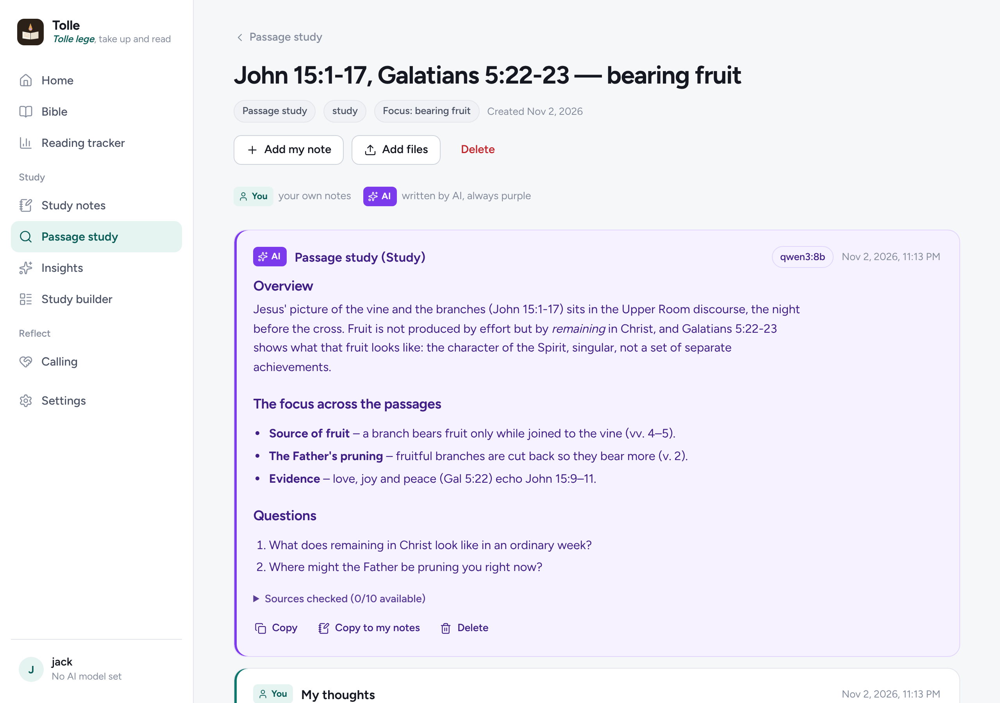

  

  <strong>An AI-assisted Bible study companion you run yourself.</strong> 
  Windows · macOS · Linux · Android · iPhone & iPad · Docker · Home Assistant

  <a href="https://github.com/shotgn16/Tolle/releases/latest"><strong>Download</strong></a> ·
  <a href="docs/manual/README.md"><strong>User manual</strong></a> ·
  <a href="docs/developer/README.md">Developer guide</a>

---

> *Tolle lege, tolle lege* – “Take up and read, take up and read.”
> Augustine heard a child's voice singing these words, picked up the Scriptures, and his life changed (*Confessions*, Book VIII).

Tolle helps you study Scripture carefully, with good sources, checking everything against the text. It reads your own notes, researches passages on trusted study sites, helps you plan studies for groups, walks with you in prayerful reflection on your calling, and tracks your time in the Word.

**Everything the AI writes is shown in purple**, so you always know what is yours and what is the AI's.

## Install

Download the installer for your computer from the **[latest release](https://github.com/shotgn16/Tolle/releases/latest)**. It contains everything Tolle needs, so there's nothing else to install first.

| Your computer | Download | Guide |
|---|---|---|
| Windows 10 or 11 | `Tolle-Setup-…-windows-x64.exe` | [Windows](docs/manual/install-windows.md) |
| Mac (Apple silicon or Intel) | `Tolle-…-macos-arm64.dmg` or `…-macos-x64.dmg` | [Mac](docs/manual/install-macos.md) |
| Linux | `Tolle-…-linux-x86_64.AppImage` or `…-linux-amd64.deb` (ARM too) | [Linux](docs/manual/install-linux.md) |

The first time Tolle opens, a setup assistant asks how you want to use it and does the rest:

- **Just me, on this computer**
- **Me, on this computer and my phone**: Tolle keeps running in the background for your phone or tablet.
- **A server for my family, group or church**: Tolle starts with the computer, and everyone has their own account.
- **Install it in Docker**, on this computer or another machine.
- **Install it in Home Assistant**, with its own sidebar panel.
- **Connect to Tolle that's already running**

It can also install a free, private AI model for you (Ollama), or connect ChatGPT, Gemini or Claude.

**A server with no screen?** One command does it: [Linux & macOS](docs/manual/install-linux.md#a-server-with-no-screen) · [Windows Server](docs/manual/install-windows.md#windows-server-without-a-desktop).

**Phones and tablets:** the Android app (`.apk`) and the iPhone & iPad app are on the release page too. Scan a code on your computer to connect. See [Phones & tablets](docs/manual/phones-and-tablets.md).

**Docker or Home Assistant directly:** [Docker](docs/manual/install-docker.md) · [Home Assistant](docs/manual/install-home-assistant.md).

## What it does

| | |
|---|---|
| **Study notes** | Write notes in Tolle, or upload PDFs, Word files and photos of handwritten notes, one at a time or in bulk. The AI reads them, breaks them down and compares them with commentaries. |
| **Passage study** | Passages plus a word, sentence or topic, at the depth you choose (Introduction, Study, Preach / Teach, In-depth) and for the purpose you choose (personal, home group, preaching, teaching, youth, word study, one-to-one). |
| **Insights** | A passage, a topic, or an area of life seen through Scripture. |
| **Study builder** | Plans for a group, a person or a meeting: passage ideas, a timed format, leader's notes and questions. |
| **Calling** | A guided time of prayer, Scripture and reflection that listens to what you share and assumes nothing. |
| **Reading tracker** | A Bible reader that logs your time and chapters, reminders, streaks, and time in the YouVersion app. |
| **Any AI** | Ollama, ChatGPT, Gemini, Claude, any OpenAI-compatible server, or a model that runs on your device. Choose the model per request and switch "thinking" on or off. |
| **Private** | Accounts for each person, and everything stored is encrypted. Your data stays on your own computer or server. |

## Make it your own

Tolle is built to be customised: switch features on and off, rewrite the AI's instructions, change the colours, or add a new screen by copying a template folder. See the [developer guide](docs/developer/README.md).

## About the study sites

Tolle reads publicly available pages for your personal study. It keeps them for 30 days so it doesn't fetch them again and again, summarises rather than copies them, and links back to every page it uses. Please respect each site's terms of use. You can change the sites in **Settings → Sources**.

## Licence

MIT. See [LICENSE](LICENSE). Bible text comes from [bible-api.com](https://bible-api.com) (public-domain translations).
